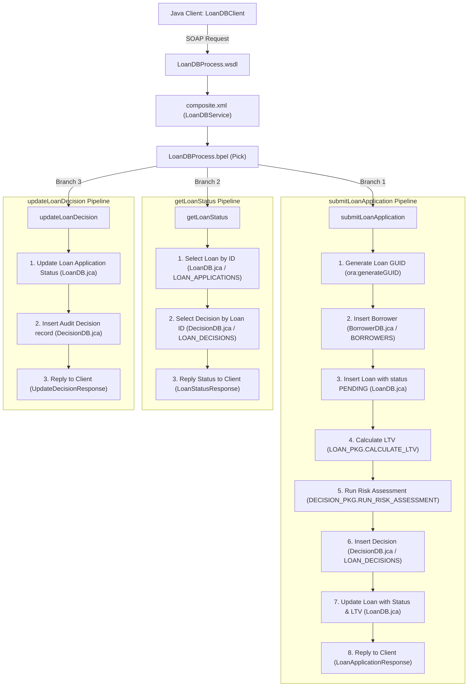

# Oracle SOA Suite Database Adapter Pattern - In-Depth Analysis

This document provides a comprehensive technical analysis of the **`Oracle_SOA_Database_Adapters`** project, explaining its architecture, end-to-end functional flows, an exhaustive catalog of all detected bugs, runtime crashes, and architectural flaws, and an inventory of unused files and dead code elements.

---

## 1. Project Architecture & Purpose

The **`Oracle_SOA_Database_Adapters`** project is a reference implementation and test fixture designed to validate static code analysis parsers (such as CodeScout / Parser 3.0) and knowledge-graph extractors (Neo4j). Its primary purpose is to model how Oracle SOA Suite 12c composites interact with relational databases through JCA Database Adapters.

### Call Chain Architecture

```
┌────────────────────────┐
│   LoanDBClient.java    │ ── (JAX-WS SOAP over HTTP)
└───────────┬────────────┘
            │
            ▼
┌────────────────────────┐
│   LoanDBProcess.wsdl   │ ── Service Endpoint: loandb_client_ep
└───────────┬────────────┘
            │
            ▼
┌────────────────────────┐
│     composite.xml      │ ── SOA Service: LoanDBService
└───────────┬────────────┘
            │
            ▼
┌────────────────────────┐
│   LoanDBProcess.bpel   │ ── SOA Component: LoanDBProcess (Pick: 3 Operations)
└───────────┬────────────┘
            │
  ┌─────────┼────────────────────────┐
  ▼         ▼                        ▼
┌──────────────────┐  ┌──────────────────┐  ┌──────────────────┐
│ LoanDBAdapter    │  │ BorrowerDBAdapter│  │ DecisionDBAdapter│
│ (LoanDB.jca)     │  │ (BorrowerDB.jca) │  │ (DecisionDB.jca) │
└─────────┬────────┘  └────────┬─────────┘  └────────┬─────────┘
          │                    │                     │
          ▼                    ▼                     ▼
┌──────────────────┐  ┌──────────────────┐  ┌──────────────────┐
│Table:            │  │Table:            │  │Table:            │
│LOAN_APPLICATIONS │  │BORROWERS         │  │LOAN_DECISIONS    │
│Pkg: LOAN_PKG     │  │                  │  │Pkg: DECISION_PKG │
└──────────────────┘  └──────────────────┘  └──────────────────┘
```

---

## 2. End-to-End Functional Flow Walkthrough

The composite exposes 3 distinct business operations through [LoanDBProcess.wsdl](file:///d:/ramu/Personal/Hexaware/Rapidx_Freddie_Rerpos/LQA_Repositories/SOA_Repositories/Oracle_SOA_Database_Adapters-main/Oracle_SOA_Database_Adapters-main/loan-db-composite/LoanDBProcess.wsdl) and implements them in [LoanDBProcess.bpel](file:///d:/ramu/Personal/Hexaware/Rapidx_Freddie_Rerpos/LQA_Repositories/SOA_Repositories/Oracle_SOA_Database_Adapters-main/Oracle_SOA_Database_Adapters-main/loan-db-composite/LoanDBProcess.bpel) using a `<pick createInstance="yes">` activity:



### Operation 1: `submitLoanApplication` (New Loan Origination Pipeline)
1. **Client Invocations**: [LoanDBClient.java](file:///d:/ramu/Personal/Hexaware/Rapidx_Freddie_Rerpos/LQA_Repositories/SOA_Repositories/Oracle_SOA_Database_Adapters-main/Oracle_SOA_Database_Adapters-main/java-client/src/com/lendwise/soa/client/LoanDBClient.java#L49) sends a SOAP request containing borrower details (`applicantName`, `ssn`, `monthlyIncome`) and collateral parameters (`loanAmount`, `propertyValue`, `propertyAddress`).
2. **GUID Creation**: BPEL executes `ora:generateGUID()` to generate a unique string `loanId`.
3. **Borrower Record Insertion**: Invokes `BorrowerDBAdapter.insertBorrower` via [BorrowerDB.jca](file:///d:/ramu/Personal/Hexaware/Rapidx_Freddie_Rerpos/LQA_Repositories/SOA_Repositories/Oracle_SOA_Database_Adapters-main/Oracle_SOA_Database_Adapters-main/loan-db-composite/adapters/BorrowerDB.jca) (`DmlType=INSERT`) storing applicant details into the `BORROWERS` table.
4. **Loan Record Initialization**: Invokes `LoanDBAdapter.insertLoanApplication` via [LoanDB.jca](file:///d:/ramu/Personal/Hexaware/Rapidx_Freddie_Rerpos/LQA_Repositories/SOA_Repositories/Oracle_SOA_Database_Adapters-main/Oracle_SOA_Database_Adapters-main/loan-db-composite/adapters/LoanDB.jca) (`DmlType=INSERT`) inserting into `LOAN_APPLICATIONS` with status `PENDING`.
5. **Stored Procedure LTV Calculation**: Invokes `LoanDBAdapter.calculateLTV` (`DBStoredProcedureInteractionSpec`), calling `LOAN_PKG.CALCULATE_LTV(p_loan_amount, p_property_value, p_ltv_ratio)`.
6. **Stored Procedure Risk Assessment**: Invokes `DecisionDBAdapter.runRiskAssessment` (`DBStoredProcedureInteractionSpec`), executing `DECISION_PKG.RUN_RISK_ASSESSMENT(loanId, creditScore, ltvRatio, monthlyIncome, loanAmount, ...)`.
7. **Decision Audit Insertion**: Invokes `DecisionDBAdapter.insertDecision` via [DecisionDB.jca](file:///d:/ramu/Personal/Hexaware/Rapidx_Freddie_Rerpos/LQA_Repositories/SOA_Repositories/Oracle_SOA_Database_Adapters-main/Oracle_SOA_Database_Adapters-main/loan-db-composite/adapters/DecisionDB.jca) (`DmlType=INSERT`) persisting the outcome in `LOAN_DECISIONS`.
8. **Application Status Update**: Invokes `LoanDBAdapter.updateLoanApplication` (`DmlType=UPDATE`) writing the final status (`APPROVED`, `MANUAL_REVIEW`, or `REJECTED`) and computed `ltvRatio` back to `LOAN_APPLICATIONS`.
9. **Client Response**: Formulates and replies with `LoanApplicationResponse`.

### Operation 2: `getLoanStatus` (Status & Decision Query Pipeline)
1. **Client Request**: Receives `loanId`.
2. **Loan Query**: Invokes `LoanDBAdapter.selectLoanById` using [LoanDB.jca](file:///d:/ramu/Personal/Hexaware/Rapidx_Freddie_Rerpos/LQA_Repositories/SOA_Repositories/Oracle_SOA_Database_Adapters-main/Oracle_SOA_Database_Adapters-main/loan-db-composite/adapters/LoanDB.jca) (`DBReadInteractionSpec` executing named query `selectLoanById` defined in [LoanDB-or-mappings.xml](file:///d:/ramu/Personal/Hexaware/Rapidx_Freddie_Rerpos/LQA_Repositories/SOA_Repositories/Oracle_SOA_Database_Adapters-main/Oracle_SOA_Database_Adapters-main/loan-db-composite/adapters/LoanDB-or-mappings.xml)).
3. **Decision Query**: Invokes `DecisionDBAdapter.selectDecisionByLoan` using [DecisionDB.jca](file:///d:/ramu/Personal/Hexaware/Rapidx_Freddie_Rerpos/LQA_Repositories/SOA_Repositories/Oracle_SOA_Database_Adapters-main/Oracle_SOA_Database_Adapters-main/loan-db-composite/adapters/DecisionDB.jca) (`DBReadInteractionSpec` executing named query `selectByLoanId` defined in [DecisionDB-or-mappings.xml](file:///d:/ramu/Personal/Hexaware/Rapidx_Freddie_Rerpos/LQA_Repositories/SOA_Repositories/Oracle_SOA_Database_Adapters-main/Oracle_SOA_Database_Adapters-main/loan-db-composite/adapters/DecisionDB-or-mappings.xml)).
4. **Client Response**: Aggregates `status`, `decision`, and `updatedAt` into `LoanStatusResponse`.

### Operation 3: `updateLoanDecision` (Manual Underwriting Review Pipeline)
1. **Client Request**: Underwriter submits `loanId`, override `decision`, and `reviewerNotes`.
2. **Application Status Update**: Invokes `LoanDBAdapter.updateLoanApplication` to overwrite the `STATUS` column in `LOAN_APPLICATIONS`.
3. **Audit Trail Recording**: Invokes `DecisionDBAdapter.insertDecision` to record a new review decision row in `LOAN_DECISIONS` with `reviewedBy = 'MANUAL_REVIEWER'`.
4. **Client Response**: Returns `UpdateDecisionResponse` with `status = 'SUCCESS'`.

---

## 3. Exhaustive Analysis of Issues, Bugs, and Architectural Flaws

A meticulous inspection of the source code, XML definitions, TopLink descriptor mappings, database schemas, and client implementations reveals **14 distinct defects and architectural flaws**, categorized below by severity.

```
Issues Breakdown by Category:
├── Critical Runtime & Engine Crashes (Defects 1 - 5)
├── Transactional & Schema Integrity Flaws (Defects 6 - 8)
├── Functional & Business Logic Defects (Defects 9 - 11)
└── Client & Environmental Discrepancies (Defects 12 - 14)
```

---

### Category A: Critical Runtime & Engine Crashes

#### Defect 1: BPEL Process-Level `<faultHandlers>` Operation Mismatch (Hang & Crash)
- **Location**: [LoanDBProcess.bpel:L82-L107](file:///d:/ramu/Personal/Hexaware/Rapidx_Freddie_Rerpos/LQA_Repositories/SOA_Repositories/Oracle_SOA_Database_Adapters-main/Oracle_SOA_Database_Adapters-main/loan-db-composite/LoanDBProcess.bpel#L82-L107)
- **Problematic Code**:
  ```xml
  <faultHandlers>
      <catchAll>
          <sequence name="HandleAllFaults">
              <assign name="AssignFaultResponse"> ... </assign>
              <reply name="ReplyFault"
                     partnerLink="LoanDBClient"
                     portType="client:LoanDBProcess"
                     operation="submitLoanApplication"
                     variable="faultVariable"
                     faultName="client:loanDBFault"/>
          </sequence>
      </catchAll>
  </faultHandlers>
  ```
- **Root Cause**: The `<faultHandlers>` block is declared at the global `<process>` level, while the inbound message exchange is handled by a `<pick>` activity supporting 3 separate operations. The `<reply>` activity inside `<catchAll>` explicitly specifies `operation="submitLoanApplication"`.
- **Consequence**: If a fault occurs while processing `getLoanStatus` or `updateLoanDecision` (e.g. database query failure, network glitch, or lock timeout), the BPEL engine executes `<catchAll>` and attempts to reply to `submitLoanApplication`. Because the active inbound channel was `getLoanStatus` (or `updateLoanDecision`), there is no open receive activity for `submitLoanApplication`.
- **Runtime Error**: The BPEL engine raises `bpel:mismatchedAssignmentFailure` or `conflictingReceive` / `no active receive for reply activity`. The client calling `getLoanStatus` or `updateLoanDecision` never receives a SOAP Fault and hangs until an HTTP read timeout occurs.
- **Remediation**: Remove the global process-level reply and wrap each `<onMessage>` branch inside a local `<scope>` having its own `<faultHandlers>` replying to its respective operation.

---

#### Defect 2: Invalid XPath Sequence Extension Function in BPEL
- **Location**: [LoanDBProcess.bpel:L141](file:///d:/ramu/Personal/Hexaware/Rapidx_Freddie_Rerpos/LQA_Repositories/SOA_Repositories/Oracle_SOA_Database_Adapters-main/Oracle_SOA_Database_Adapters-main/loan-db-composite/LoanDBProcess.bpel#L141)
- **Problematic Code**:
  ```xml
  <copy>
      <from>ora:getNextSequenceValue('BORROWER_SEQ')</from>
      <to>$borrowerInsertRequest.BorrowerCollection/types:Borrower/types:borrowerId</to>
  </copy>
  ```
- **Root Cause**: Oracle SOA Suite BPEL does not define a 1-parameter `ora:getNextSequenceValue()` function in the standard XPath extension library (`xmlns:ora="http://schemas.oracle.com/xpath/extension"`).
- **Consequence**: When executed in Oracle WebLogic SOA Suite, the engine throws:
  `XPathSubFunctionException: Function 'ora:getNextSequenceValue' not found`.
- **Remediation**: Use the standard Oracle extension function requiring both sequence name and dataSource JNDI:
  ```xml
  <from>oraext:sequence-next-val('BORROWER_SEQ', 'eis/DB/LendWiseDS')</from>
  ```
  Or configure sequence generation directly in the TopLink descriptor mapping or database trigger.

---

#### Defect 3: Missing JAX-WS Annotations on Java Client Port Interface
- **Location**: [LoanDBClient.java:L166-L170](file:///d:/ramu/Personal/Hexaware/Rapidx_Freddie_Rerpos/LQA_Repositories/SOA_Repositories/Oracle_SOA_Database_Adapters-main/Oracle_SOA_Database_Adapters-main/java-client/src/com/lendwise/soa/client/LoanDBClient.java#L166-L170)
- **Problematic Code**:
  ```java
  // Supporting classes (normally generated from WSDL)
  interface LoanDBProcessPort {
      LoanApplicationResponse submitLoanApplication(LoanApplicationRequest request);
      LoanStatusResponse getLoanStatus(String loanId);
      UpdateDecisionResponse updateLoanDecision(UpdateDecisionRequest request);
  }
  ```
  Invoked in constructor via:
  ```java
  this.port = service.getPort(LoanDBProcessPort.class);
  ```
- **Root Cause**: `LoanDBProcessPort` is a plain Java interface devoid of `@WebService`, `@WebMethod`, `@SOAPBinding`, or `@WebResult` annotations. Furthermore, the accompanying data transfer objects (`LoanApplicationRequest`, `LoanApplicationResponse`, etc.) lack `@XmlType` and `@XmlRootElement` JAXB annotations.
- **Consequence**: Under standard JAX-WS runtime (JDK standard or Metro/CXF), calling `service.getPort(LoanDBProcessPort.class)` immediately throws:
  `javax.xml.ws.WebServiceException: LoanDBProcessPort is not an interface annotated with @WebService`. The client fails before issuing any network request.
- **Remediation**: Annotate `LoanDBProcessPort` with `@WebService(targetNamespace = "http://xmlns.oracle.com/LendWise/LoanDBProcess")` or generate the client stubs directly using `wsimport`.

---

#### Defect 4: Uninitialized XML Document in BPEL Assignment (`selectionFailure`)
- **Location**: [LoanDBProcess.bpel:L140-L156](file:///d:/ramu/Personal/Hexaware/Rapidx_Freddie_Rerpos/LQA_Repositories/SOA_Repositories/Oracle_SOA_Database_Adapters-main/Oracle_SOA_Database_Adapters-main/loan-db-composite/LoanDBProcess.bpel#L140-L156)
- **Problematic Code**:
  ```xml
  <assign name="PrepareBorrowerInsert">
      <copy>
          <from>ora:getNextSequenceValue('BORROWER_SEQ')</from>
          <to>$borrowerInsertRequest.BorrowerCollection/types:Borrower/types:borrowerId</to>
      </copy>
      <copy>
          <from>$inputVariable.payload/types:ssn</from>
          <to>$borrowerInsertRequest.BorrowerCollection/types:Borrower/types:ssn</to>
      </copy>
      ...
  </assign>
  ```
- **Root Cause**: In WS-BPEL, variable `$borrowerInsertRequest` is defined as a message variable with part `BorrowerCollection`. When the process starts, the variable payload is null/empty. Assigning to sub-elements like `/types:Borrower/types:borrowerId` when the parent XML elements do not exist causes standard BPEL engines to throw `bpws:selectionFailure`.
- **Consequence**: The process fails immediately on the very first database preparation step unless elements are pre-initialized or Oracle extension `<bpelx:insertMissingToData="yes"/>` is explicitly added to each `<copy>` activity.
- **Remediation**: Add `insertMissingToData="yes"` on all target assignments or initialize the XML payload structure first.

---

#### Defect 5: Unchecked Division by Zero in Stored Procedure
- **Location**: [create_loan_tables.sql:L148-L154](file:///d:/ramu/Personal/Hexaware/Rapidx_Freddie_Rerpos/LQA_Repositories/SOA_Repositories/Oracle_SOA_Database_Adapters-main/Oracle_SOA_Database_Adapters-main/database/schema/create_loan_tables.sql#L148-L154)
- **Problematic Code**:
  ```sql
  -- Calculate DTI (assuming monthly loan payment is ~0.6% of loan amount)
  v_dti_ratio := ((p_loan_amount * 0.006) / p_monthly_income) * 100;
  ```
- **Root Cause**: In `DECISION_PKG.RUN_RISK_ASSESSMENT`, `p_monthly_income` is used directly as a divisor without verifying if it is greater than zero. In [LoanDBTypes.xsd](file:///d:/ramu/Personal/Hexaware/Rapidx_Freddie_Rerpos/LQA_Repositories/SOA_Repositories/Oracle_SOA_Database_Adapters-main/Oracle_SOA_Database_Adapters-main/loan-db-composite/LoanDBTypes.xsd), `monthlyIncome` has no schema validation constraint preventing `0.0`.
- **Consequence**: When an applicant has no reported monthly income (`0`), Oracle PL/SQL halts execution with `ORA-01476: divisor is equal to zero`, causing the stored procedure adapter call to abort and rolling into the fault handler.
- **Remediation**: Guard against zero or null income:
  ```sql
  IF p_monthly_income IS NOT NULL AND p_monthly_income > 0 THEN
      v_dti_ratio := ((p_loan_amount * 0.006) / p_monthly_income) * 100;
  ELSE
      v_dti_ratio := 999; -- Force high risk or fail validation
  END IF;
  ```

---

### Category B: Transactional & Schema Integrity Flaws

#### Defect 6: Non-Transactional JCA Adapters (`GetActiveUnitOfWork = false`) Cause Orphaned Records
- **Location**: [LoanDB.jca:L23](file:///d:/ramu/Personal/Hexaware/Rapidx_Freddie_Rerpos/LQA_Repositories/SOA_Repositories/Oracle_SOA_Database_Adapters-main/Oracle_SOA_Database_Adapters-main/loan-db-composite/adapters/LoanDB.jca#L23), [BorrowerDB.jca:L23](file:///d:/ramu/Personal/Hexaware/Rapidx_Freddie_Rerpos/LQA_Repositories/SOA_Repositories/Oracle_SOA_Database_Adapters-main/Oracle_SOA_Database_Adapters-main/loan-db-composite/adapters/BorrowerDB.jca#L23), [DecisionDB.jca:L23](file:///d:/ramu/Personal/Hexaware/Rapidx_Freddie_Rerpos/LQA_Repositories/SOA_Repositories/Oracle_SOA_Database_Adapters-main/Oracle_SOA_Database_Adapters-main/loan-db-composite/adapters/DecisionDB.jca#L23)
- **Problematic Code**:
  ```xml
  <property name="GetActiveUnitOfWork" value="false"/>
  ```
- **Root Cause**: In [composite.xml:L72](file:///d:/ramu/Personal/Hexaware/Rapidx_Freddie_Rerpos/LQA_Repositories/SOA_Repositories/Oracle_SOA_Database_Adapters-main/Oracle_SOA_Database_Adapters-main/loan-db-composite/composite.xml#L72), the BPEL process participates in global transactions:
  `<property name="bpel.config.transaction" type="xs:string" many="false">required</property>`.
  However, all 3 database adapters configure `<property name="GetActiveUnitOfWork" value="false"/>`, causing each interaction to execute in its own autocommit local transaction rather than enlisting in WebLogic's JTA global transaction.
- **Consequence**: In `submitLoanApplication`, Step 2 inserts a borrower and Step 3 inserts a loan application. If Step 5 (`runRiskAssessment`) subsequently fails, the transaction aborts. Because the adapters did not enlist in the active Unit of Work, **the inserted borrower and loan application records are permanently committed to the database as orphaned records in `PENDING` state with no decision audit entry**.
- **Remediation**: Set `<property name="GetActiveUnitOfWork" value="true"/>` across all JCA endpoint interactions to guarantee two-phase commit (2PC) rollback.

---

#### Defect 7: Schema Field Mismatch in `BorrowerType` (`UPDATED_AT` Missing from XSD)
- **Location**: [BorrowerDB-or-mappings.xml:L60-L64](file:///d:/ramu/Personal/Hexaware/Rapidx_Freddie_Rerpos/LQA_Repositories/SOA_Repositories/Oracle_SOA_Database_Adapters-main/Oracle_SOA_Database_Adapters-main/loan-db-composite/adapters/BorrowerDB-or-mappings.xml#L60-L64) vs [LoanDBTypes.xsd:L86-L95](file:///d:/ramu/Personal/Hexaware/Rapidx_Freddie_Rerpos/LQA_Repositories/SOA_Repositories/Oracle_SOA_Database_Adapters-main/Oracle_SOA_Database_Adapters-main/loan-db-composite/LoanDBTypes.xsd#L86-L95)
- **Mismatched Definitions**:
  - In `BorrowerDB-or-mappings.xml`:
    ```xml
    <toplink:attribute-mapping xsi:type="toplink:direct-mapping">
        <toplink:attribute-name>updatedAt</toplink:attribute-name>
        <toplink:field table="BORROWERS" name="UPDATED_AT" xsi:type="toplink:column"/>
    </toplink:attribute-mapping>
    ```
  - In `LoanDBTypes.xsd`:
    ```xml
    <xsd:complexType name="BorrowerType">
        <xsd:sequence>
            <xsd:element name="borrowerId" type="xsd:long"/>
            <xsd:element name="ssn" type="xsd:string"/>
            <xsd:element name="name" type="xsd:string"/>
            <xsd:element name="creditScore" type="xsd:int" minOccurs="0"/>
            <xsd:element name="monthlyIncome" type="xsd:decimal"/>
            <xsd:element name="createdAt" type="xsd:dateTime" minOccurs="0"/>
            <!-- NOTE: updatedAt is COMPLETELY MISSING -->
        </xsd:sequence>
    </xsd:complexType>
    ```
- **Consequence**: TopLink is instructed to map database column `UPDATED_AT` to object attribute `updatedAt`. If query `selectBorrowerBySSN` were executed, TopLink's XML/object serializer would attempt to marshal an attribute `updatedAt` that does not exist in the XML schema definition for `BorrowerType`, violating XML validation.
- **Remediation**: Add `<xsd:element name="updatedAt" type="xsd:dateTime" minOccurs="0"/>` to `BorrowerType` in [LoanDBTypes.xsd](file:///d:/ramu/Personal/Hexaware/Rapidx_Freddie_Rerpos/LQA_Repositories/SOA_Repositories/Oracle_SOA_Database_Adapters-main/Oracle_SOA_Database_Adapters-main/loan-db-composite/LoanDBTypes.xsd).

---

#### Defect 8: Unconditional Borrower Insert Causes `ORA-00001` Unique SSN Violation
- **Location**: [create_loan_tables.sql:L23](file:///d:/ramu/Personal/Hexaware/Rapidx_Freddie_Rerpos/LQA_Repositories/SOA_Repositories/Oracle_SOA_Database_Adapters-main/Oracle_SOA_Database_Adapters-main/database/schema/create_loan_tables.sql#L23), [LoanDBProcess.bpel:L140-L163](file:///d:/ramu/Personal/Hexaware/Rapidx_Freddie_Rerpos/LQA_Repositories/SOA_Repositories/Oracle_SOA_Database_Adapters-main/Oracle_SOA_Database_Adapters-main/loan-db-composite/LoanDBProcess.bpel#L140-L163)
- **Root Cause**: Table `BORROWERS` defines:
  `SSN VARCHAR2(11) NOT NULL UNIQUE`.
  However, `submitLoanApplication` in BPEL always attempts to execute `insertBorrower`.
- **Consequence**: If an existing borrower applies for a second mortgage loan (or re-submits a loan application), the database rejects the insert with:
  `ORA-00001: unique constraint (LENDWISE.SYS_C...) violated on BORROWERS(SSN)`.
- **Remediation**: BPEL must first invoke `BorrowerDBAdapter.selectBorrowerBySSN`. If the borrower already exists, reuse the existing `borrowerId`; only if the query returns empty should `insertBorrower` be invoked.

---

### Category C: Functional & Business Logic Defects

#### Defect 9: Ambiguous XPath Selection in `getLoanStatus` Returns Old/Stale Decision
- **Location**: [LoanDBProcess.bpel:L427](file:///d:/ramu/Personal/Hexaware/Rapidx_Freddie_Rerpos/LQA_Repositories/SOA_Repositories/Oracle_SOA_Database_Adapters-main/Oracle_SOA_Database_Adapters-main/loan-db-composite/LoanDBProcess.bpel#L427)
- **Offending Code**:
  ```xml
  <copy>
      <from>$decisionSelectResponse.LoanDecisionCollection/types:LoanDecision/types:decision</from>
      <to>$statusOutputVariable.payload/types:decision</to>
  </copy>
  ```
- **Root Cause**: When an application is reviewed and modified via `updateLoanDecision`, a new row is appended to `LOAN_DECISIONS`. Query `selectByLoanId` returns all decisions matching the `loanId` (e.g., Row 1: `MANUAL_REVIEW`, Row 2: `APPROVED`).
- **Consequence**: Standard XPath 1.0/2.0 node-set evaluation in copy rules selects the **first** element when no index predicate is supplied. Thus, `getLoanStatus` returns the original automatic decision (`MANUAL_REVIEW`) instead of the underwriter's latest approved decision (`APPROVED`), defeating the purpose of the manual review operation.
- **Remediation**: Use the `[last()]` predicate to target the newest decision record:
  ```xml
  <from>$decisionSelectResponse.LoanDecisionCollection/types:LoanDecision[last()]/types:decision</from>
  ```

---

#### Defect 10: Hardcoded Credit Score Bypasses Actual Borrower Data
- **Location**: [LoanDBProcess.bpel:L250](file:///d:/ramu/Personal/Hexaware/Rapidx_Freddie_Rerpos/LQA_Repositories/SOA_Repositories/Oracle_SOA_Database_Adapters-main/Oracle_SOA_Database_Adapters-main/loan-db-composite/LoanDBProcess.bpel#L250)
- **Offending Code**:
  ```xml
  <copy>
      <from>number(720)</from> <!-- Default credit score for demo -->
      <to>$riskAssessmentRequest.RiskAssessmentInput/types:creditScore</to>
  </copy>
  ```
- **Consequence**: Although the database schema supports `CREDIT_SCORE NUMBER(3)` in `BORROWERS`, the BPEL process ignores actual borrower credit history and hardcodes `720`. Every applicant automatically earns `300` points in the credit score tier of `DECISION_PKG.RUN_RISK_ASSESSMENT`, undermining the validity of automated underwriting.
- **Remediation**: Read `creditScore` from the borrower database record or pass it as an input attribute in `LoanApplicationRequest`.

---

#### Defect 11: `UPDATED_AT` Timestamp Is Never Maintained
- **Location**: [LoanDBProcess.bpel:L324-L343](file:///d:/ramu/Personal/Hexaware/Rapidx_Freddie_Rerpos/LQA_Repositories/SOA_Repositories/Oracle_SOA_Database_Adapters-main/Oracle_SOA_Database_Adapters-main/loan-db-composite/LoanDBProcess.bpel#L324-L343), [LoanDBProcess.bpel:L455-L471](file:///d:/ramu/Personal/Hexaware/Rapidx_Freddie_Rerpos/LQA_Repositories/SOA_Repositories/Oracle_SOA_Database_Adapters-main/Oracle_SOA_Database_Adapters-main/loan-db-composite/LoanDBProcess.bpel#L455-L471)
- **Consequence**: In `updateLoanApplication` (during both Step 6 of initial origination and `updateLoanDecision`), the BPEL copy assignments only set `loanId`, `ltvRatio`, and `status`. No assignment sets `updatedAt`, and no `BEFORE UPDATE` trigger exists on `LOAN_APPLICATIONS`. Consequently, `UPDATED_AT` in `LOAN_APPLICATIONS` remains permanently frozen at the original record creation timestamp.

---

### Category D: Client & Environmental Discrepancies

#### Defect 12: Java Client Data Type Mismatch (`double` vs `BigDecimal`)
- **Location**: [LoanDBClient.java:L175-L177](file:///d:/ramu/Personal/Hexaware/Rapidx_Freddie_Rerpos/LQA_Repositories/SOA_Repositories/Oracle_SOA_Database_Adapters-main/Oracle_SOA_Database_Adapters-main/java-client/src/com/lendwise/soa/client/LoanDBClient.java#L175-L177) vs [LoanDBTypes.xsd:L23-L25](file:///d:/ramu/Personal/Hexaware/Rapidx_Freddie_Rerpos/LQA_Repositories/SOA_Repositories/Oracle_SOA_Database_Adapters-main/Oracle_SOA_Database_Adapters-main/loan-db-composite/LoanDBTypes.xsd#L23-L25)
- **Consequence**: In [LoanDBTypes.xsd](file:///d:/ramu/Personal/Hexaware/Rapidx_Freddie_Rerpos/LQA_Repositories/SOA_Repositories/Oracle_SOA_Database_Adapters-main/Oracle_SOA_Database_Adapters-main/loan-db-composite/LoanDBTypes.xsd), financial amounts are typed as `xsd:decimal`, which maps by JAX-WS standard to `java.math.BigDecimal`. In [LoanDBClient.java](file:///d:/ramu/Personal/Hexaware/Rapidx_Freddie_Rerpos/LQA_Repositories/SOA_Repositories/Oracle_SOA_Database_Adapters-main/Oracle_SOA_Database_Adapters-main/java-client/src/com/lendwise/soa/client/LoanDBClient.java), they are declared as primitive `double`. This leads to floating-point representation inaccuracy when dealing with currency amounts and unmarshalling issues.

---

#### Defect 13: Stored Procedure Parameter Naming Mismatch in JCA Adapters
- **Location**: [LoanDB.jca:L50-L57](file:///d:/ramu/Personal/Hexaware/Rapidx_Freddie_Rerpos/LQA_Repositories/SOA_Repositories/Oracle_SOA_Database_Adapters-main/Oracle_SOA_Database_Adapters-main/loan-db-composite/adapters/LoanDB.jca#L50-L57), [DecisionDB.jca:L39-L46](file:///d:/ramu/Personal/Hexaware/Rapidx_Freddie_Rerpos/LQA_Repositories/SOA_Repositories/Oracle_SOA_Database_Adapters-main/Oracle_SOA_Database_Adapters-main/loan-db-composite/adapters/DecisionDB.jca#L39-L46)
- **Consequence**: For stored procedures, Oracle DB Adapter expects an adapter-generated schema where element names match the SQL parameter names (e.g., `P_LOAN_AMOUNT`, `P_PROPERTY_VALUE`, `P_LTV_RATIO`). The project instead uses [LoanDBTypes.xsd](file:///d:/ramu/Personal/Hexaware/Rapidx_Freddie_Rerpos/LQA_Repositories/SOA_Repositories/Oracle_SOA_Database_Adapters-main/Oracle_SOA_Database_Adapters-main/loan-db-composite/LoanDBTypes.xsd) with camelCase tags (`loanAmount`, `propertyValue`) without declaring parameter binding properties in the JCA files. This syntax works for static AST graph parsers but fails at runtime on WebLogic SOA Suite.

---

#### Defect 14: Incomplete Database Privileges Script
- **Location**: [create_loan_tables.sql:L12-L13](file:///d:/ramu/Personal/Hexaware/Rapidx_Freddie_Rerpos/LQA_Repositories/SOA_Repositories/Oracle_SOA_Database_Adapters-main/Oracle_SOA_Database_Adapters-main/database/schema/create_loan_tables.sql#L12-L13)
- **Consequence**: `GRANT RESOURCE TO LENDWISE;` is commented out. In Oracle Database, `GRANT CONNECT` only provides `CREATE SESSION`. Running this script on a clean Oracle DB fails with `ORA-01031: insufficient privileges` on `CREATE TABLE`, `CREATE SEQUENCE`, and `CREATE PACKAGE`.

---

## 4. Master Defect & Issue Summary Matrix

| # | Defect Title | Impacted File(s) | Severity | Root Cause |
|---|--------------|------------------|----------|------------|
| **1** | Fault Handler Operation Mismatch | `LoanDBProcess.bpel:82` | **Critical** | Global catchAll hardcodes `<reply>` to `submitLoanApplication`, crashing `getLoanStatus` and `updateLoanDecision`. |
| **2** | Invalid Sequence Function | `LoanDBProcess.bpel:141` | **Critical** | `ora:getNextSequenceValue()` does not exist in Oracle BPEL; throws `XPathSubFunctionException`. |
| **3** | Missing JAX-WS Annotations | `LoanDBClient.java:166` | **Critical** | Interface lacks `@WebService`, throwing `WebServiceException` on client startup. |
| **4** | Uninitialized Target XML Elements | `LoanDBProcess.bpel:140` | **High** | Copying into empty message variable part without `insertMissingToData="yes"` causes `bpws:selectionFailure`. |
| **5** | Division by Zero in Stored Proc | `create_loan_tables.sql:152` | **High** | `p_monthly_income = 0` causes unhandled `ORA-01476: divisor is equal to zero` in PL/SQL. |
| **6** | Non-Transactional DB Adapters | `LoanDB.jca`, `BorrowerDB.jca` | **High** | `GetActiveUnitOfWork = false` disables JTA enlistment; partial failures leave orphaned `PENDING` records. |
| **7** | Schema Mismatch in `BorrowerType` | `LoanDBTypes.xsd:86`, `BorrowerDB-or-mappings.xml:60` | **Medium** | TopLink maps `UPDATED_AT` to `updatedAt`, but `updatedAt` is omitted from `BorrowerType` in XSD. |
| **8** | Unique SSN Constraint Collision | `create_loan_tables.sql:23`, `LoanDBProcess.bpel:140` | **Medium** | Always inserts borrower; duplicate applications fail with `ORA-00001` unique constraint violation. |
| **9** | Ambiguous XPath in `getLoanStatus` | `LoanDBProcess.bpel:427` | **Medium** | Lacks `[last()]` predicate; returns oldest automatic decision rather than updated manual review decision. |
| **10** | Hardcoded Credit Score | `LoanDBProcess.bpel:250` | **Medium** | Hardcodes `720` for all applicants; bypasses borrower credit check. |
| **11** | Stale `UPDATED_AT` Timestamp | `LoanDBProcess.bpel:324`, `LoanDBProcess.bpel:455` | **Low** | Application updates never assign `updatedAt`; timestamp permanently frozen at creation time. |
| **12** | Client Floating Point Typing | `LoanDBClient.java:175` | **Low** | Uses `double` instead of `BigDecimal` for `xsd:decimal` financial figures. |
| **13** | Stored Proc Parameter Mapping | `LoanDB.jca:50`, `DecisionDB.jca:39` | **Low** | CamelCase elements in XSD vs uppercase PL/SQL procedure arguments without mapping spec. |
| **14** | Incomplete DB Privileges Script | `create_loan_tables.sql:12` | **Low** | `GRANT RESOURCE` commented out; `CONNECT` cannot create tables or packages in standard Oracle. |

---

## 5. Inventory of Unused Files, Dead Code, and Unreferenced Elements

### File-Level Audit
An audit confirms that **all 16 files are wired into the project structure**; there are no orphaned files:

| # | File Path | Status | Reference Link in Project |
|---|-----------|--------|---------------------------|
| 1 | `README.md` | Active | Root documentation |
| 2 | `database/schema/create_loan_tables.sql` | Active | Defines database schema for adapters |
| 3 | `java-client/src/com/lendwise/soa/client/LoanDBClient.java` | Active | Calls composite SOAP endpoint |
| 4 | `loan-db-composite/composite.xml` | Active | Root SCA composite wiring |
| 5 | `loan-db-composite/LoanDBProcess.wsdl` | Active | Imported by `composite.xml` and client |
| 6 | `loan-db-composite/LoanDBTypes.xsd` | Active | Imported by all WSDLs |
| 7 | `loan-db-composite/LoanDBProcess.bpel` | Active | Implements component in `composite.xml` |
| 8 | `loan-db-composite/adapters/LoanDB.wsdl` | Active | Imported by `composite.xml` and BPEL |
| 9 | `loan-db-composite/adapters/LoanDB.jca` | Active | Referenced by `LoanDBAdapter` in `composite.xml` |
| 10 | `loan-db-composite/adapters/LoanDB-or-mappings.xml` | Active | Referenced by `LoanDB.jca` (`MappingsMetaDataURL`) |
| 11 | `loan-db-composite/adapters/BorrowerDB.wsdl` | Active | Imported by `composite.xml` and BPEL |
| 12 | `loan-db-composite/adapters/BorrowerDB.jca` | Active | Referenced by `BorrowerDBAdapter` in `composite.xml` |
| 13 | `loan-db-composite/adapters/BorrowerDB-or-mappings.xml` | Active | Referenced by `BorrowerDB.jca` (`MappingsMetaDataURL`) |
| 14 | `loan-db-composite/adapters/DecisionDB.wsdl` | Active | Imported by `composite.xml` and BPEL |
| 15 | `loan-db-composite/adapters/DecisionDB.jca` | Active | Referenced by `DecisionDBAdapter` in `composite.xml` |
| 16 | `loan-db-composite/adapters/DecisionDB-or-mappings.xml` | Active | Referenced by `DecisionDB.jca` (`MappingsMetaDataURL`) |

### Dead Code & Unreferenced Component Elements

```
Dead Code Elements Tree:
├── LoanDBProcess.bpel
│   ├── Variable: borrowerSelectRequest (Line 55) - Declared, never used
│   └── Variable: borrowerSelectResponse (Line 56) - Declared, never used
├── BorrowerDB.wsdl
│   ├── Operation: selectBorrowerBySSN (Lines 38-47) - Never invoked by BPEL
│   └── Operation: updateBorrowerCredit (Lines 49-57) - Never invoked by BPEL
├── BorrowerDB.jca
│   ├── Interaction: selectBorrowerBySSN (Lines 27-36) - Unused adapter binding
│   └── Interaction: updateBorrowerCredit (Lines 38-47) - Unused adapter binding
├── BorrowerDB-or-mappings.xml
│   └── Named Query: selectBySSN (Lines 80-96) - Unused query
└── README.md
    └── Directory Tree (Lines 58-64) - Omits the three *-or-mappings.xml files
```

1. **Unused BPEL Variables**:
   - `borrowerSelectRequest` ([LoanDBProcess.bpel:L55](file:///d:/ramu/Personal/Hexaware/Rapidx_Freddie_Rerpos/LQA_Repositories/SOA_Repositories/Oracle_SOA_Database_Adapters-main/Oracle_SOA_Database_Adapters-main/loan-db-composite/LoanDBProcess.bpel#L55))
   - `borrowerSelectResponse` ([LoanDBProcess.bpel:L56](file:///d:/ramu/Personal/Hexaware/Rapidx_Freddie_Rerpos/LQA_Repositories/SOA_Repositories/Oracle_SOA_Database_Adapters-main/Oracle_SOA_Database_Adapters-main/loan-db-composite/LoanDBProcess.bpel#L56))
2. **Unused DB Adapter Operations**:
   - `selectBorrowerBySSN` in [BorrowerDB.wsdl:L38-L47](file:///d:/ramu/Personal/Hexaware/Rapidx_Freddie_Rerpos/LQA_Repositories/SOA_Repositories/Oracle_SOA_Database_Adapters-main/Oracle_SOA_Database_Adapters-main/loan-db-composite/adapters/BorrowerDB.wsdl#L38-L47) and [BorrowerDB.jca:L27-L36](file:///d:/ramu/Personal/Hexaware/Rapidx_Freddie_Rerpos/LQA_Repositories/SOA_Repositories/Oracle_SOA_Database_Adapters-main/Oracle_SOA_Database_Adapters-main/loan-db-composite/adapters/BorrowerDB.jca#L27-L36).
   - `updateBorrowerCredit` in [BorrowerDB.wsdl:L49-L57](file:///d:/ramu/Personal/Hexaware/Rapidx_Freddie_Rerpos/LQA_Repositories/SOA_Repositories/Oracle_SOA_Database_Adapters-main/Oracle_SOA_Database_Adapters-main/loan-db-composite/adapters/BorrowerDB.wsdl#L49-L57) and [BorrowerDB.jca:L38-L47](file:///d:/ramu/Personal/Hexaware/Rapidx_Freddie_Rerpos/LQA_Repositories/SOA_Repositories/Oracle_SOA_Database_Adapters-main/Oracle_SOA_Database_Adapters-main/loan-db-composite/adapters/BorrowerDB.jca#L38-L47).
3. **Unused TopLink Named Query**:
   - Query `selectBySSN` in [BorrowerDB-or-mappings.xml:L80-L96](file:///d:/ramu/Personal/Hexaware/Rapidx_Freddie_Rerpos/LQA_Repositories/SOA_Repositories/Oracle_SOA_Database_Adapters-main/Oracle_SOA_Database_Adapters-main/loan-db-composite/adapters/BorrowerDB-or-mappings.xml#L80-L96).
4. **Documentation Discrepancy in `README.md`**:
   - In [README.md:L58-L64](file:///d:/ramu/Personal/Hexaware/Rapidx_Freddie_Rerpos/LQA_Repositories/SOA_Repositories/Oracle_SOA_Database_Adapters-main/Oracle_SOA_Database_Adapters-main/README.md#L58-L64), the file tree omits `BorrowerDB-or-mappings.xml`, `LoanDB-or-mappings.xml`, and `DecisionDB-or-mappings.xml`, even though all three are actively required by the `.jca` files.
